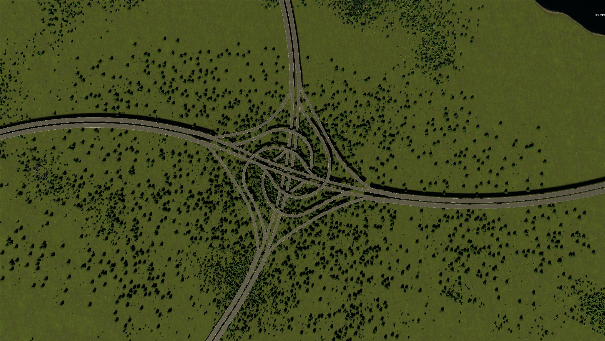
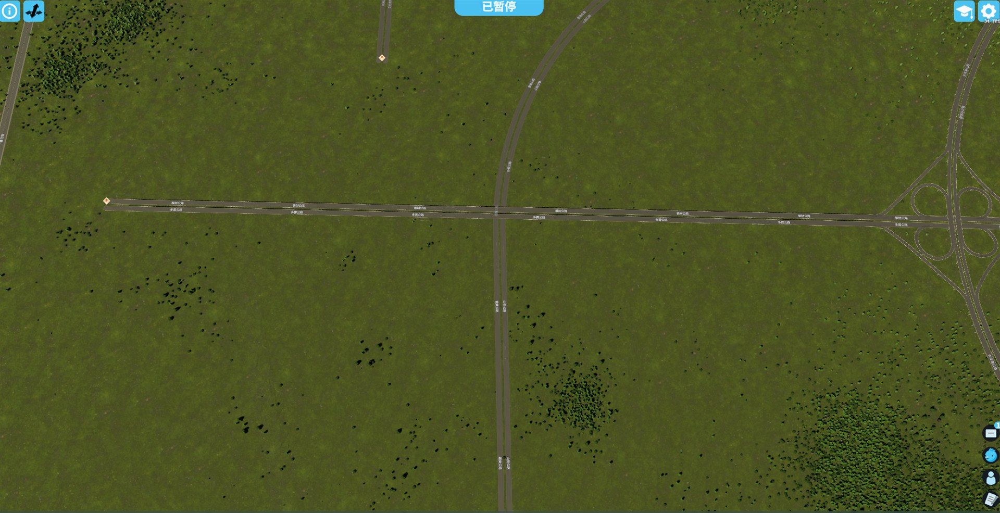
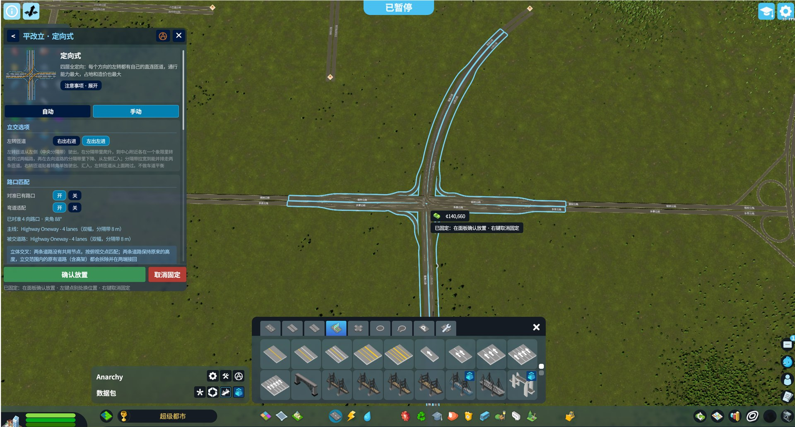
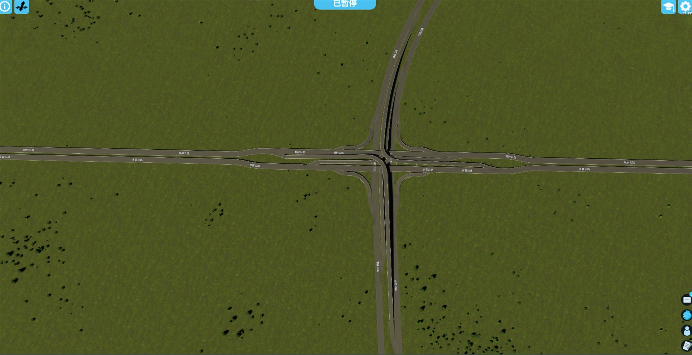
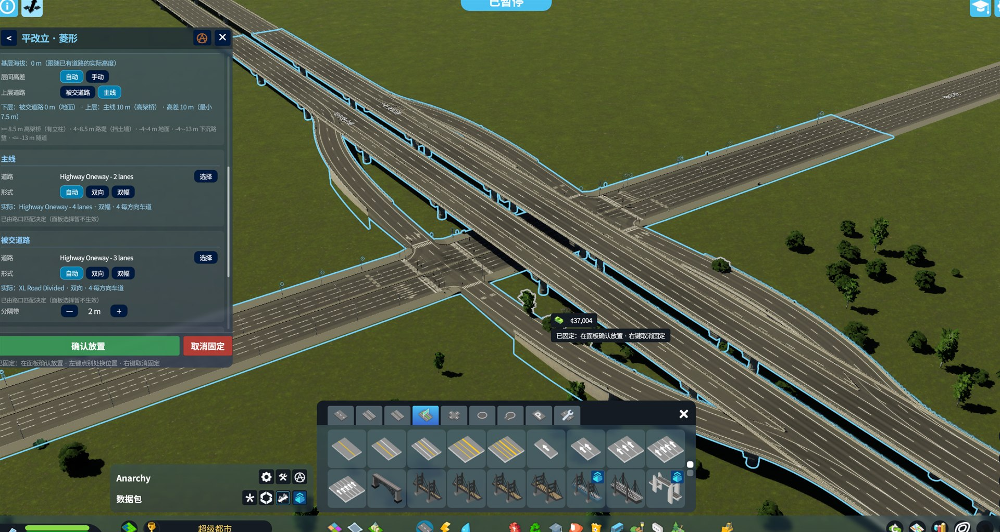
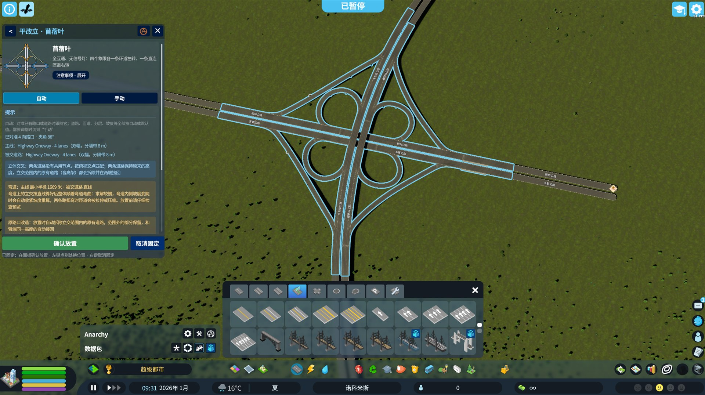
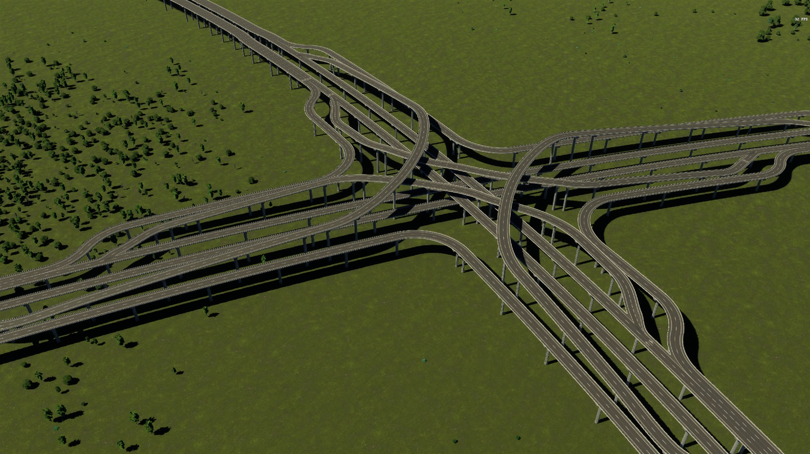

# section2change（平改立）

A Cities: Skylines II mod that places a **complete interchange in one placement**: pick a type, aim at an existing junction, crossing or road (or empty ground), check the preview, confirm.

一个天际线 2 mod：**一次放下一整座立交**。选类型，对准已有路口、立体交叉或道路（也可以在空地上），确认预览后放置。中文名“平改立”取自道路工程里的“平面交叉改立体交叉”。

Current version: **1.0.8-beta** · License: [MIT](LICENSE)



| Before 原路口 | Preview 预览 | After 放置后 |
|---|---|---|
|  |  |  |

| Diamond 菱形 | Cloverleaf 苜蓿叶 | Stack 定向 |
|---|---|---|
|  |  |  |

## Features · 功能

- **13 interchange types** — four-way: diamond, single-point, Chinese expressway node, cloverleaf, partial cloverleaf, roundabout, stack, turbine; three-way: expressway T, trumpet, semi-directional T, directional T; wye
  **13 种立交**：四向的菱形、单点、中式快速路节点、苜蓿叶、部分苜蓿叶、环岛、定向、涡轮；三向的快速路 T 型、喇叭形、半定向 T、定向 T；Y 型分向
- **Upgrade existing junctions** — matches roads, levels and angle, removes the old junction and reconnects every leg; roads passing under bridges with enough clearance are kept
  **平改立**：自动匹配原有道路、层高和交角，拆掉原路口并接回各臂；桥下净空够的道路保留
- **Curves and slopes** — follows curved roads (radius ≥ 150 m) and places the whole interchange on the roads' grade
  **弯道和坡道**：顺着弯道整体弯曲，按原有道路的坡度整体放置
- **Lane balance, edge-aligned lane drops, pillars placed clear of roads below, grade and clearance checks before placing**
  车道平衡、边缘对齐的减车道、立柱避开下层道路、放置前检查坡度和净空
- **Auto mode** (point and confirm) and **manual mode** (every parameter adjustable); Chinese and English UI
  **自动模式**一指即放，**手动模式**可调所有参数；中英文界面

## Usage · 使用

1. Open the tool with the button at the top left or **Shift + I**. 左上角按钮或 **Shift + I** 打开。
2. Pick a type. Hover a junction / road to match it, or empty ground. 选类型，鼠标对准路口、道路或空地。
3. Left-click to pin the preview, check the result and errors in the panel, then **Confirm**. 左键固定预览，看面板里的结果和报错，点“确认放置”。

Read the in-game guide on first use. Key points: 首次打开会显示使用指南，要点：

- **Placement cannot be undone** (the game does not support undo) — save first if in doubt. **放置后不能撤销**，必要时先存档。
- Works best on flat ground with straight, uniform-grade roads; keep road type and curvature steady within the interchange. 最好在平地、平直且坡度均匀的道路上使用。
- Trumpet, semi-directional / directional T, stack, turbine and wye support right-hand traffic only. 喇叭形、定向类、涡轮、Y 型目前只支持右侧通行。

## Reporting bugs · 反馈问题

Please [open an issue](https://github.com/zilianli/section2change/issues/new/choose) with a screenshot of the panel and the mod log:
请附面板截图和 mod 日志提交 issue：

`%USERPROFILE%\AppData\LocalLow\Colossal Order\Cities Skylines II\Logs\InterchangeMod.Mod.log`

Turn on **debug logging** in the mod settings before reproducing — the log then records the junction and parameters so the case can be replayed exactly.
复现前在 mod 设置里打开**调试日志**，日志会记下路口和参数，便于一比一还原。

## Building · 构建

Requirements: Cities: Skylines II with the official modding toolchain, .NET SDK, Node.js.

```bash
cd src/InterchangeMod && DOTNET_ROLL_FORWARD=Major dotnet build -c Release
```

Builds stage the complete package in `.artifacts/staging`. Install UI dependencies with `npm ci` in `src/InterchangeMod.UI` first. To deploy to the game after closing Cities2, use `dotnet msbuild src/InterchangeMod/InterchangeMod.csproj -restore -t:Build -p:Configuration=Release -p:DeployToGame=true` from the repository root. Keep `DOTNET_ROLL_FORWARD=Major` if only .NET 8 is installed. Deployment refuses a running game.

默认构建仅暂存到 `.artifacts/staging`。关闭游戏后，显式指定 `DeployToGame=true` 才部署。水中替换及涡轮/定向式长臂修复已获用户游戏验证；范围与限制见 [1.0.8 发布说明](docs/11-发布说明-1.0.8.md)。

```bash
cd tests && DOTNET_ROLL_FORWARD=Major dotnet test InterchangeMod.Generation.Tests
```

- `src/InterchangeMod.Generation` — game-independent geometry (templates, matching, curve warp), unit-tested
- `src/InterchangeMod` — game integration (tool system, placement, removal)
- `src/InterchangeMod.UI` — panel (React / TypeScript)
- `docs/` — design notes (Chinese) 设计文档

## License

[MIT](LICENSE) © 2026 Ifliz
