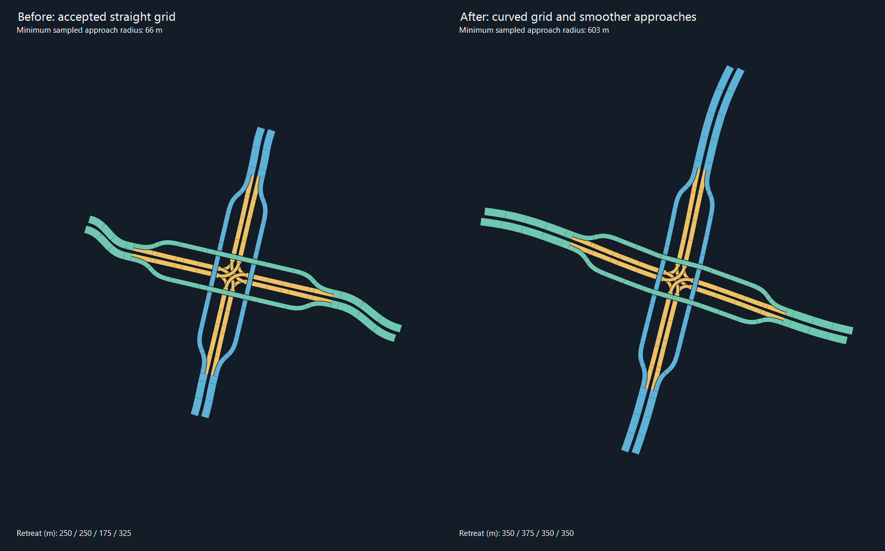

# 井字弯曲核心与接入外观优化

2026-11-01，autochange，0.0.1-beta。玩家确认上一包叠放已修复，本轮处理汇入曲线不平滑。正式放置继续锁定，不提交或发布。

## 基线与问题

玩家已验收的无叠放场景日志保存于 `.artifacts/autochange/game-grid-appearance-feedback.log`。04:01记录真实弯路16%：140段预览道路，退接250/250/175/325米，无随后原生错误。该反馈只记为上一包在玩家场景的验收，不自动视作本轮弯曲布局已在游戏通过。

此前井字核心保持直线，外部接路负责吸收方向变化，并在找到第一条安全候选后立即返回。真实曲线回放的全宽接路采样峰值曲率分别约0.015242/m（16%）和0.011032/m（30%），约66米和91米采样半径；在已满足最小安全半径的情况下，仍形成明显的外部反向S弯。

## 方法

- 保留原求解为安全基线，后续优化与基线共享最多128次完整候选尝试；最多8组原路退接向量。预算用尽或没有安全且更平顺的方案时返回已认证基线，不把成功预览变成失败。
- 沿用section2change及已验证定向/涡轮的EndpointCoreBend/CurveWarp：按同一组实际切点重定参考，道路、匝道、逻辑节点和端口一起弯曲；保持四层世界高程。完整、半量、四分之一弯曲和直线候选参与比较。
- 采用既有接路峰值曲率、接缝曲率跳变与弯曲能量评分，仅在评分降低且所有安全认证通过时替换基线。
- 按弯曲后的真实曲线长度划分桥跨，重新检查实际最大跨距、道路半径、严格纵坡、路径简单性、20链/8端口/12方向动作、双幅间隔、全网净空和真实桥墩。
- 整体非线性变换会产生厘米级宽度对齐误差。本轮独立复核发现后，新增变换后重绑定：全幅曲线与逻辑节点不动，两条减道曲线按变换后的全幅法向及真实宽度差精确对齐，端部控制柄与全幅切线一致。重绑定后再次执行全部安全认证。
- 面板区分“已随原路曲线匹配”和“采用平直布局，外围接回原路”；日志记录实际弯曲状态与评分，不将直线回退称为已弯曲。

## 回归与外观证据

初始4项真实弯路外观回归全部失败，均因未采用弯曲核心。实现后左右通行、16%/30%通过。独立复核新增的曲线边缘对齐4项先失败（纵向误差最大约0.1米），重绑定后通过；原始0.001米横向、0.002米纵向容差未放宽。

最终256项相关回归通过：包括已验收边缘对齐、两组真实道路、宽分隔带、实际桥墩、严格坡度，以及预算恰好用尽时完整基线几何/距离/身份保持不变4项、非法弯曲强度原子拒绝3项。独立复核无剩余阻断项。

| 指标 | 16% RHT及LHT镜像 | 30% RHT及LHT镜像 |
|---|---|---|
| 基线四臂退接/米 | 250/250/175/325 | 175/200/100/250 |
| 本轮四臂退接/米 | 350/375/350/350 | 275/250/275/275 |
| 全宽接路采样峰值曲率（前→后） | 0.015242→0.001659/m | 0.011032→0.001756/m |
| 对应采样最急半径（前→后） | 约66→603米 | 约91→570米 |
| 接路评分（前→后，越小越好） | 约246.00→20.83 | 约182.15→21.48 |
| 完整候选尝试（含基线） | 128 | 128 |

半径为128点/曲线的采样外观摘要，另有保守连续曲率认证；不得把“603米采样半径”称为全网络统一半径或游戏车速。八个原路接点及切向仍精确保持。退接距离不是立交半径；本次16%场景四臂较已验收方案分别增加100/125/175/25米，用原退接上限内的空间换取平顺接入。

下图由实际生成Bezier控制点按真实路宽绘制，仅为俯视几何，颜色区分道路链，不是游戏截图，也不验证原生形状/桥墩/交通。

导出JSON与四组对比图：`.artifacts/autochange/grid-appearance-after/`。回归记录：`.artifacts/autochange/test-results/grid-appearance-targeted-final.trx`。

UI类型检查通过；最终Release构建0错误，保留1项既有StackTemplate.cs的CS8619警告。完整回归1979项全部通过，0失败、0跳过，持续6分18秒，结果 `.artifacts/autochange/test-results/grid-appearance-full.trx`。27个暂存文件逐一哈希核验一致，生成器DLL SHA256为 `40A9FA721130F3C80F73FBAA3F4EDDBDAF9480E5C0331E0FD42D0877ADE6A7AD`。

部署清单 `.artifacts/autochange/deployment-grid-appearance-manifest.json`。2026-11-01 15:29（Australia/Adelaide），玩家正常关闭游戏后已完成备份与部署；安装版本0.0.1-beta，27个文件SHA256逐一核验一致，差异0。旧包备份 `.artifacts/autochange/installed-before-grid-appearance-20261101-152946`。原生形状与外观仍待游戏复测。

## 玩家复测

1. 原弯路16%场景，观察面板是否显示已随原路曲线匹配，比较横向接路的反向S弯和汇入鼓包。
2. 同场景30%再测一次，检查汇入曲线、道路边缘、桥墩与原生形状/叠放提示。
3. 原直路/混合高程场景回归；确认不需要弯曲时保持平直布局。

本轮数学、俯视图和静态复核不替代游戏外观及原生碰撞验收。
