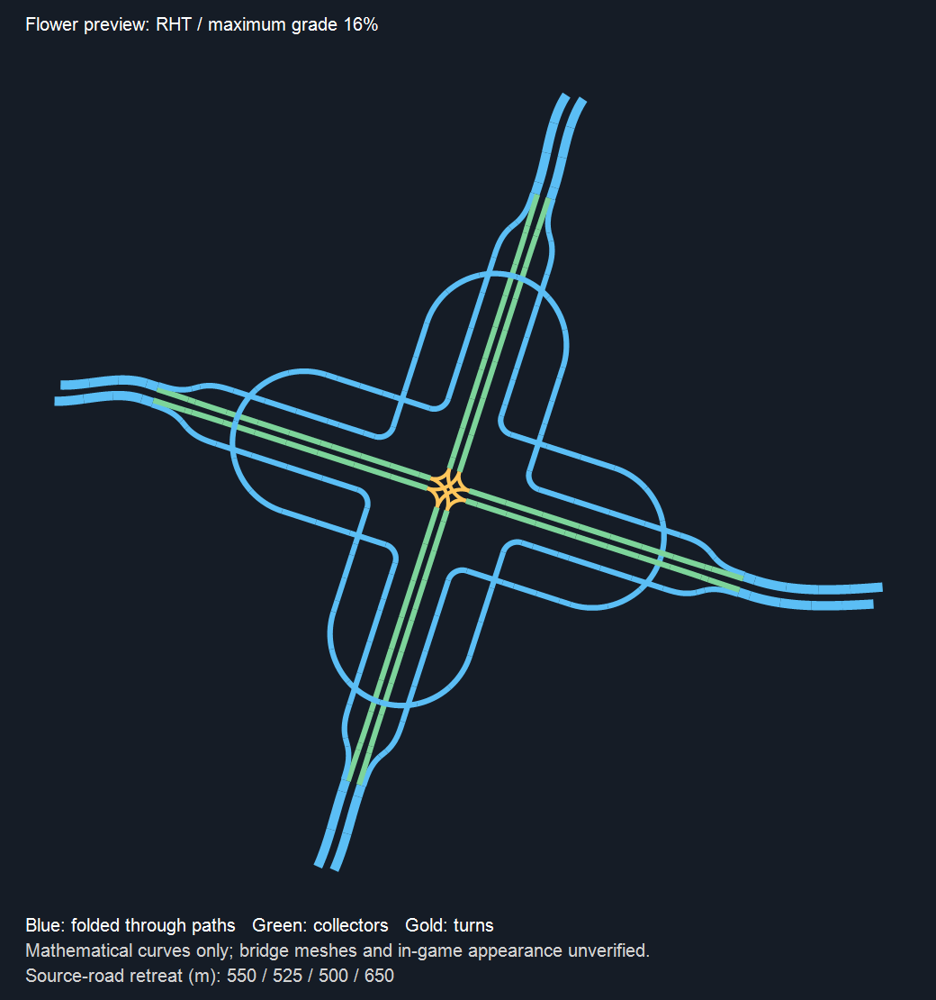

# autochange 梅花立交首轮节点预览

**已停用：2026-11-01 玩家认为该类型不实用，要求移除并直接开发环岛。本文保留作历史记录，当前功能及测试说明见 41-autochange环岛节点预览与梅花下线.md。**

版本：0.0.1-beta；独立 autochange 分支。井字匝道外观由玩家确认通过，本轮继续资产参考开发顺序。

## 本轮变化

1. 井字立交：相对道路轴线偏离直角超过 1° 时，增加提示：“斜交道路的中央空间较小，桥墩可能与道路冲突；出现叠放提示时，请手动开启无碰撞放置。”提示不自动开关无碰撞，也不隐藏游戏原生报警。玩家提出中央空间不足的判断在此作为使用提示，未声称已独立证明全部桥墩冲突原因。
2. 新增“梅花立交”，参考提供的 asset04 丁香花路网拓扑。四个外侧折返花瓣组织直行，中央两层集散道处理左右转，完整保留四入口到其他三出口的 12 种流向，不引入同臂掉头。
3. 使用真实道路目录分配车道：入口 N＝直行 T＋左转 R＋右转 R，集散为 2R；分合流边缘对齐，并使用已验证的平滑横移、纵坡缓和方法。

## 如何测试

- 选择“梅花立交”后进入“点选节点”，按方向分组选择八个开放端点，每组一进一出。
- 首轮每幅至少三车道；同组及相对方向须使用同款同宽道路。默认转向各一车道，四车道入口保留两车道直行，五车道保留三车道直行。
- 先测平直同高道路，再测原有弯路、混合高度。可从 16% 最大纵坡和每臂 1000m 退接上限开始。
- 检查八个接点、四个花瓣、中央高低层是否完整；观察分合流、纵坡和桥墩报警。原生报错仍会显示在面板和日志。
- 正式放置继续锁定，这一包用于实验预览；不要把预览及数学回归当作实际通车验证。

## 尺寸与边界

本轮为通过实际路面和桥墩校验而重新求解的保守布局，未按资产缩放粘贴。参考资产中 GUID 对应的真实车道和宽度尚未核对，不将其直接当作本 Mod 的道路断面。

核心基准测试中，每幅 3／4／5 车道、8–30% 最大纵坡的保守路面外包半径约 462–641m。该数值是控制点凸包加真实半路宽的上界，包含核心短段，既不是最小占地半径，也不是退接距离，且不包括外部接路。说明首版总体尺寸偏保守，后续可继续紧凑化。

弯曲场景使用退接后的割线重定中心并生成真实曲线过渡；当前梅花核心没有使用整体弯曲变形，`CoreFollowsCurve=false`。井字既有弯曲核心与拟合流程保持原有行为。

## 验证记录

- 独立核心与菜单/提示初始 RED：53 项按预期失败于缺少实现。
- 桥墩与纵坡调整后，37 项核心回归通过。
- 核心、实际道路分配、菜单设置、井字提示、真实捕获弯路及混合高度整合回归：67/67 通过。
- UI TypeScript 类型检查、webpack 构建通过；只有现存 Sass 旧 JS API 弃用提示。
- 完整 Generation 回归：2050/2050 通过，0 失败、0 跳过，耗时 8 分 52 秒。
- Release Mod 构建成功，0 错误；仅有原有 `StackTemplate.cs:698` 空引用类型警告。暂存包 28 个文件，版本 `0.0.1-beta`。
- 两轮独立静态代码审查均通过，覆盖独立几何核心和类型/UI/实际运行时接线。
- 部署状态：玩家正常关闭游戏后已完成备份和部署；版本 `0.0.1-beta`，全部 28 文件 SHA256 与暂存包一致，独立复核 0 差异。清单在 `.artifacts/autochange/deployment-flower-manifest.json`，旧包备份路径记录在清单内。
- 新增功能的游戏外观、原生桥墩生成及实际通车仍待玩家验证。

纯数学曲线图（不是游戏截图）：

## 开发决策

- 沿用已批准的方案 B 和依次开发资产参考类型范围，未重复请求实施许可；若顺序理解不符，可独立调整下一类型。
- 五车道默认三车道直行、左右转各一；仅在实际目录精确满足方程时采用有效的玩家首选匝道，否则选择最少转向车道。
- 几何预案中花瓣间距不足以避开实际桥墩，因而扩大并延后爬升，保留全部校验；代价是首版占地偏大。
- 新增类型保持八端点预览和正式放置锁定；下一步仍为环岛，不新增菱形、单点、中式快速路节点几何。
