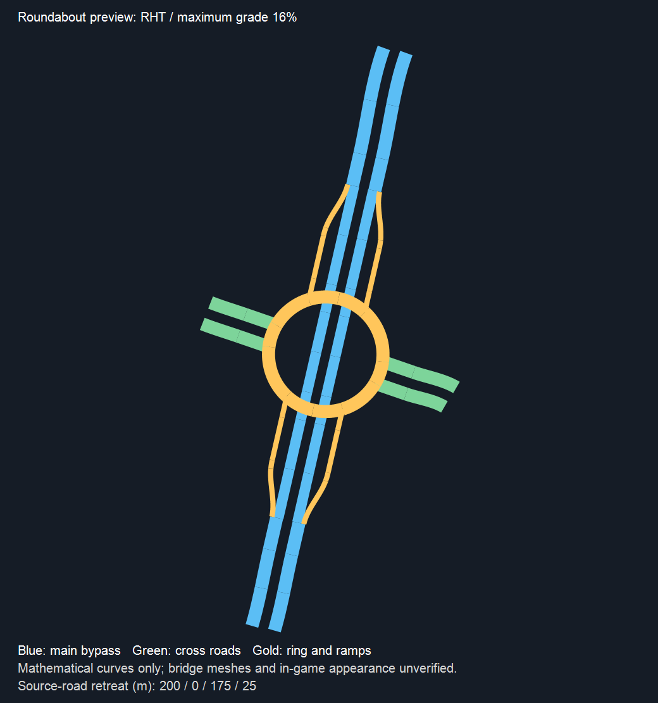

# autochange 环岛节点预览与梅花下线

**后续状态：本记录描述首轮锁定放置的测试包。环岛接路优化及节点确认放置已进入下一轮，当前流程见 42-autochange环岛平滑接路与节点确认放置.md。**

版本：0.0.1-beta，分支 autochange。

## 本轮功能

- 按玩家要求停止梅花开发，移除其菜单、注册、运行时分支、专属求解器、测试及图标。保留原始参考资产、历史记录及旧包备份。旧设置 `CompactFlower` 经直接反序列化属性或面板设置入口均转为 `Roundabout`。
- 环岛点选节点模式沿用 section2change 的两层结构：方向 1/3（内部索引 0/2）为贯通主线，另两方向接环道，主线匝道连接环道。新增点选节点预览，原有自动/手动环岛继续保留。
- 支持圆环和跑道形、左右行、实际道路宽度与车道、混合端点高度和真实弯路退接。主线分出至汇入之间按目录精确减去匝道车道 N-R；被交道路直接接环道，不作无依据减车道。
- 环道按被交道路类别选择真实单行道路，车道数至少为两车道及被交道路每幅车道数。上下层使用真实全宽、减车道、匝道、环道的保守结构包络，自动层差至少 10m。
- 原有每臂最多 1000m 有界退接、最大 30% 纵坡、实际曲率、桥跨、路面、桥墩检查及井字斜交人工无碰撞提示保留。无碰撞不自动打开，原生报错不屏蔽，正式放置继续锁定。

## 原模板最小修正

1. 减车道道路与原道路等宽时，原来因横移量为 0 而没有替换预制体。现在按有效减车道预制体决定替换；等宽时保留全部几何坐标。回归已验证修正前失败、修正后真实替换且坐标不动。
2. 圆环的同圆心两段圆弧在被交道路接口附近多出人工切点，导致一段环道进入路口包络却没有关联真实路口节点。圆形半环改为单条解析半圆后，仍按真实路口和桥跨切分；圆心、半径、切向和跑道形保持。没有放宽路面检查。

## 证明与边界

- 195 项相关回归通过：38 项核心、125 项原环岛模板、10 项实际接路整合、21 项设置、1 项注册测试。
- 图论检查八个独立外部端口、完整环道、12 种非同臂流向；环岛还允许合法同臂绕行，不能套用其他立交禁止掉头的图论规则。
- 捕获的真实弯路中，右行圆环 16% 上限使用各臂退接 200/0/175/25m；左行跑道形 30% 使用 250/175/175/175m。这些是特定场景的求解结果，不是固定尺寸承诺。
- 核心通过退接后割线重定中心和方向，外部接路保持原端点和实际切向。此包不宣称整个环岛核心随原路弯曲变形，`CoreFollowsCurve=false`。
- UI 类型检查与打包通过；Release 构建成功、0 错误，仅有原有 StackTemplate.cs:698 类型可空性警告。
- 两轮独立静态审查通过。完整 Generation 回归 2047/2047 通过，0 失败、0 跳过，耗时 5 分 21 秒。
- 游戏关闭状态下已备份旧包并部署，版本 0.0.1-beta；安装目录 27 个文件，独立 SHA256 复核 0 差异、梅花图标 0 个。清单与备份路径见 `.artifacts/autochange/deployment-roundabout-manifest.json`。
- 游戏外观、原生桥墩、车道连接、让行及实际交通仍待玩家验证。

上图是实际求解曲线的平面图，蓝色为贯通主线，绿色为被交道路，金色为环道和匝道；不是游戏截图，也不显示桥墩网格。

## 玩家首轮测试

1. 进入“环岛式 → 点选节点”，选八个开放端点，方向 1/3 作为主线两端。主线每幅至少两车道，相对方向须同款同宽。
2. 先测圆环、16% 坡度，再切跑道形；然后复测已使用的真实弯路和混合高度场景。
3. 检查主线直行、四条匝道、被交道路出入口是否完整，减车道方向是否正确，以及是否出现叠放、净空、形状或坡度报警。
4. 此阶段保持实验预览，正式放置锁定。反馈形态和警告即可，不能据此声称已实车通行。

## 开发决策

沿用已批准的方案 B 与既有环岛结构，保持独立工作分支；不扩大到菱形、单点或中式快速路新节点几何，不提交或推送。
