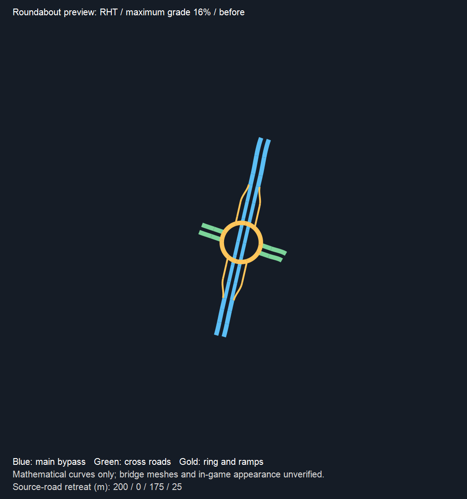
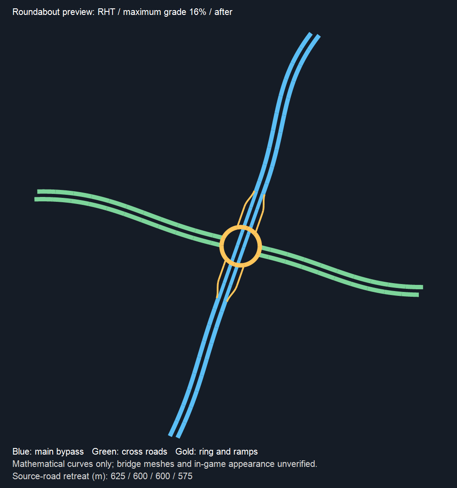

# autochange 环岛平滑接路与节点确认放置

版本：0.0.1-beta；独立 autochange 分支。玩家已确认上一轮环岛除弯路接入外的项目通过，本轮依据截图修正接路外观，并按要求开放确认放置。

## 曲线优化

原环岛搜索返回第一个满足最小半径、坡度和净空的方案，短距离接路仍可能急弯。现在先保留这个安全基准，再在同一 128 次完整候选总预算内，比较更协调的退接距离和接路曲线，只接受评分改善且全部原有检查通过的结果。没有可行改善时保留原方案，原本平直的接路不额外搜索。

| 捕获场景 | 峰值曲率（1/m） | 汇入曲率跳变累计（1/m） | 最终各臂退接距离 |
| --- | --- | --- | --- |
| 右行圆环，16% 坡度上限 | 0.01702853 → 0.00172423 | 0.07665773 → 0.00776614 | 625/600/600/575m |
| 左行跑道形，30% 坡度上限 | 0.00482919 → 0.00184409 | 0.03124105 → 0.00849272 | 500/450/500/425m |

这是特定真实弯路捕获数据的数学结果，不是游戏效果验收。较长退接换取更缓曲线；环道本身继续采用原解析结构，`CoreFollowsCurve=false`，不宣称整座环岛跟随原路弯曲。玩家可降低“自动退接上限/臂”限制改造范围。

下图使用同一平面比例和坐标范围，蓝色为主线、绿色为被交道路、金色为环道和匝道。图中只显示求解道路，未画被保留的外围原路，也不显示游戏桥墩网格。

## 确认放置

现有九种已实现节点类型使用同一确认流程：苜蓿叶、定向、涡轮、喇叭、定向T、半定向T、Y型、井字、环岛。未实现的双向/双幅转换和类型限制没有解除。

- 地图左键仍用于选择端点。预览生成后，只有面板“确认放置”可以提交，须保持游戏暂停。
- 按钮等待同一批实际原生临时道路连续稳定，并以游戏 GetAllowApply 结果决定是否可确认。没有自动开启无碰撞或过滤原生阻止错误。
- 界面将其实际显示的预览修订号发送给后端；旧界面事件不能提交重建后的新预览。无参旧确认入口在节点模式拒绝。
- 确认时重新读取完整原路路廊，按原退接距离重新切分并比较快照；同时只读核验实际边版本、曲线、原节点连接、预制体、地形、接回节点和保留尾段。变化或检查异常会使预览失效，原路不提前删除。
- 确认只将当前已检查的原生临时定义批次交给 ApplyMode.Apply，不重新生成未检查的定义，也不单独直接删除真实道路。消费后立即清除确认资格和旧选择，防止重复提交。不承诺游戏原生提交后的额外自定义回滚或自动存档备份。

## 验证

- 初始质量回归在两个捕获场景按预期失败，放置状态和快照新 API 在实现前按预期失败。
- 最终针对性回归 48/48 通过，包括旧界面 R1 与后端成熟 R2 的确认隔离、原路变动、保留尾段、修订号、单次消费、曲率改善、预算和安全基准回退。
- 当前安装 Game.dll 的 GetAllowApply 已用 Mono.Cecil 读取 IL 核对：只检查原生 Error 查询/ignoreErrors 与 OriginalDeleted 结果，没有预览成熟判定。因此本 Mod 额外要求实际 Temp 批次连续稳定。
- 两部分独立审查及界面修订号修正后的专项复核通过；UI TypeScript 与 Release 构建通过，0 错误，仅有原有 StackTemplate.cs:698 类型可空性警告及 Sass 弃用提示。
- 完整 Generation 回归 2085/2085 通过，0 失败、0 跳过，耗时 5 分 31 秒。
- 玩家正常关闭游戏后已备份旧包并部署；安装版本 0.0.1-beta，27 个文件全部 SHA256 核验一致，独立复查 0 差异。清单和备份路径见 `.artifacts/autochange/deployment-node-placement-manifest.json`。
- 代码、契约和几何测试不等于实际游戏放置成功。

## 玩家验收顺序

1. 在测试存档中重选截图的八个端点，检查弯路接入是否平缓，查看白色接点与虚线改造范围。
2. 待确认按钮可用，先放置一座环岛。检查范围内原路是否按预览改造、范围外道路及保留尾段是否保留、八个接点是否接通。
3. 放置后让车辆通行，再保存并重载，复查道路连接。然后再测试其余类型。
4. 另测取消、更改参数后立即确认、快速重复点击确认；过期或重复请求不得额外拆路或重复生成。

后续玩家反馈“通过，继续”，记录为上一轮实际测试通过；未逐项说明的类型、左右行、通行和保存重载场景不推定已经全部验收。本轮双向／双幅混合输入扩展另见《43-autochange双向与双幅混合道路支持》。
