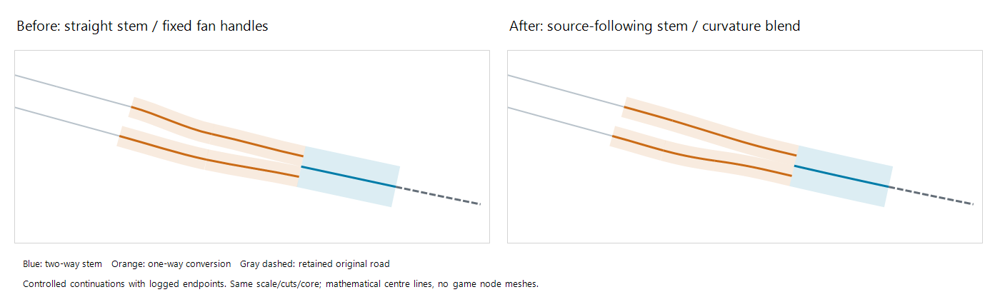

# 混合环岛曲线接入优化

分支 `autochange`；版本保持 `0.0.1-beta`。玩家已反馈上一轮全双向／混合环岛预览、放置无错误，本轮继续改善弯路汇入外观；该反馈不代表新曲线已经实机验收。

## 问题与方案

原环岛平滑器只评价内部核心外接曲线；双向转双幅连接在其后追加，采用直线双向干线及固定控制点的单向连接。接点虽然保持切向一致，连接段与核心、分叉、保留原路之间仍可能有明显曲率跳变。

本轮保留已验证的内部核心和实际外侧切点，新增可选外观优化：

- 沿冻结的实际原路在外侧切点内侧取分叉位置、切线和纵坡，使双向干线顺着原路弯势接回。
- 对分叉首段和连接核心的曲线尝试匹配水平曲率，并继续保持三维切向与纵坡连续。
- 原安全方案生成后，最多再尝试9个完整候选，计入原有共享128次预算。只接受峰值曲率不增加、曲率跳变减少且综合评分改善的方案；全部仍检查原宽度、车道、坡度、半径、单跨长度、方向锥、净空和支撑。
- 原路近似直线时返回原方案，不改造型；没有更平滑且安全的候选时，返回已检查的原候选。实际原路改变则拒绝旧来源数据，不将旧预览带入新来源。
- 仅对包含双向输入的环岛开启。原全双幅路径、其它类型转换、源路精确快照与原生确认流程保持原行为。没有屏蔽游戏报错或自动开启无碰撞。

内侧叉点位于本来就要重建的范围，几何取样不再套用“原路保留尾段至少10米”的规则；真正外切点仍执行原尾段及距离限制。这一边界由独立审查发现、回归先失败后修正。

## 数学外观验证

测试采用20:21成功预览日志显示的六个端点位置／方向和道路断面，向外延伸曲线为可控构造。它不是完整真实存档重放，也不模拟游戏的节点网格。

| 受控场景 | 峰值曲率：原→新（1/m） | 曲率跳变总量：原→新（1/m） |
| --- | --- | --- |
| 圆环，左右行镜像 | 0.008764 → 0.003531（约降60%） | 0.052427 → 0.011657（约降78%） |
| 跑道形 | 0.012625 → 0.004007（约降68%） | 0.070059 → 0.015416（约降78%） |
| 圆环，原路3%纵坡 | 0.013535 → 0.004108（约降70%） | 0.076179 → 0.012884（约降83%） |

同一比例、相同实际外切点和核心的数学曲线对比：

蓝色为双向干线，橙色为单向转换，虚线为保留原路；不代表游戏原生道路宽度或节点网格已验收。

新增12项回归还覆盖预算、源路变化拒绝、精确直路回退、内部叉点处原路剩5米仍可取样，以及三维接点切向。143项综合回归通过，独立审查的问题已闭合，Release构建0错误、仅原有 `StackTemplate.cs:698` 可空类型警告。

完整回归2200/2200通过，0失败、0跳过，耗时10分2秒。玩家正常关闭游戏后已备份并部署；安装版本仍为 `0.0.1-beta`，27个文件SHA256一致，独立复查安装文件及135个记录源文件均0差异。核验时间2026-11-02 21:18:17（Adelaide）。清单 `.artifacts/autochange/deployment-native-roundabout-manifest.json`，备份 `.artifacts/autochange/installed-before-native-roundabout-20261102-211816`。安装Generation DLL SHA256：`8EB04066B8523C402C859DDD451A01235A6B2856C51C42CFA7BD85A583F708F6`。

新包的实际节点网格、外观及通行仍待玩家复测，数学图和曲率指标不替代游戏验收。

## 玩家复测

重选原场景端点，先保持16%坡度及原退接上限，分别测试圆形和跑道形预览。重点看右侧双向道路收拢处是否顺着原路曲线接回、有没有突然反弯，随后再测试放置及通行。若安全检查使优化回退，保留旧可行方案，不保证每组输入都得到相同程度的外观改善。
